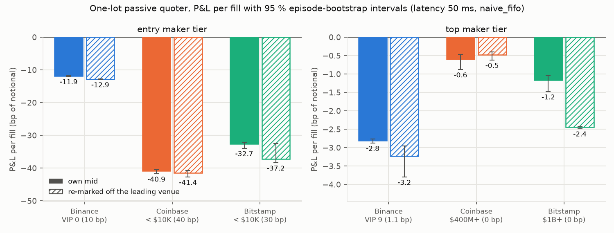
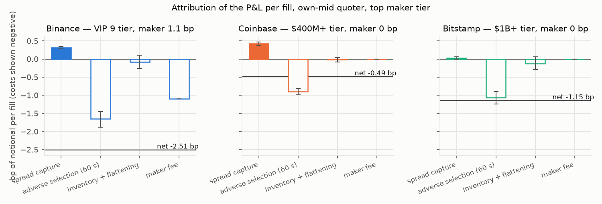
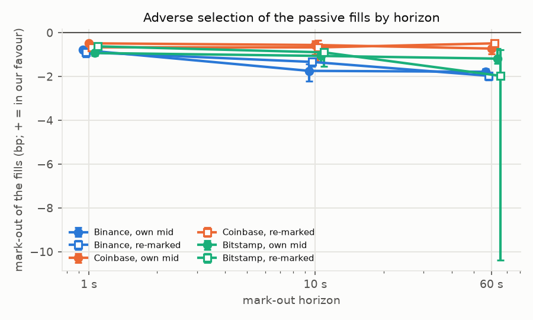
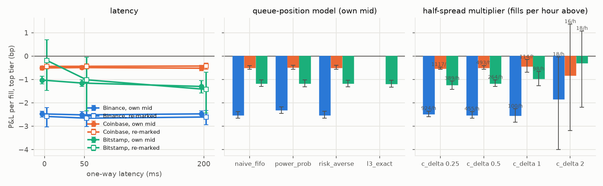
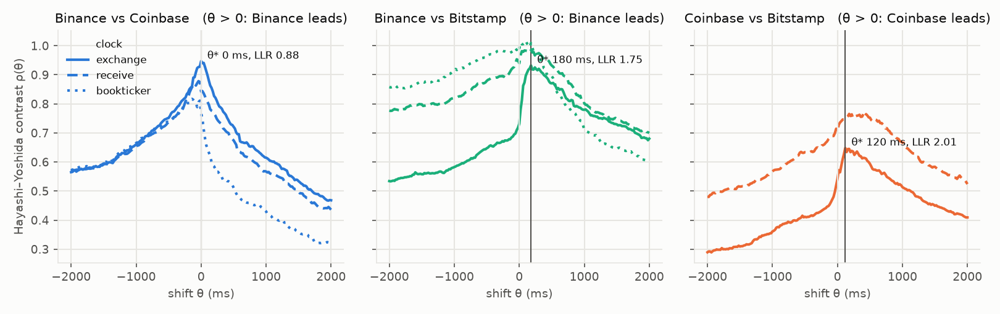
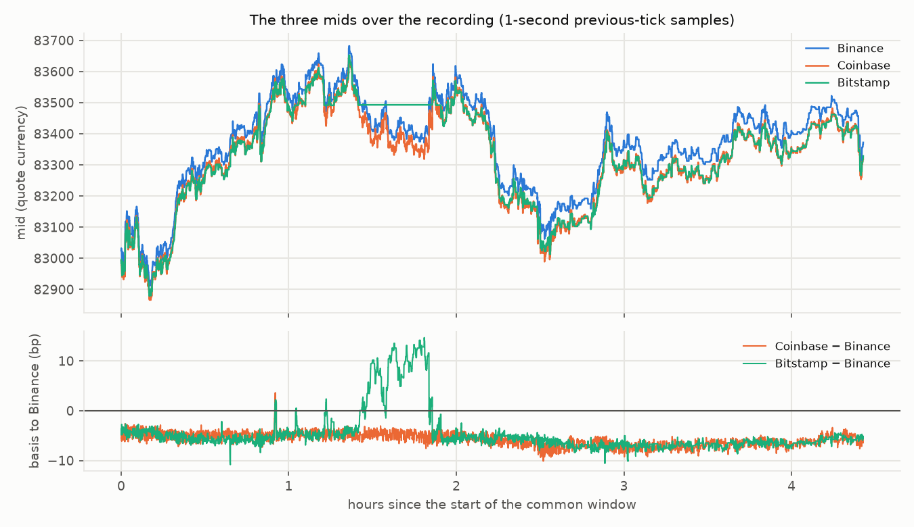

# cross-venue-crypto-quoter — what a one-lot passive quoter earns per fill on three BTC spot books, by maker-fee tier, and what re-marking off the leading venue adds

**Question.** A crypto market maker quotes the same coin on several exchanges at once. On the Binance, Coinbase and Bitstamp BTC spot books, what does a one-lot inventory-skewed passive quoter earn per fill once spread capture, adverse selection, inventory and the venue's maker fee are all charged — at the entry fee tier and at the top tier — and does re-marking the quote off the venue that leads add anything?

**Answer (§Results; one recording session on one day, 2026-10-07, 0.5 h).** Replayed with queue-position fills on 0.5 hours of self-recorded order books, the quoter (0.01 BTC per order, half spread and inventory skew set by the mid's short-horizon volatility, quotes pulled after 10 s) is paid for with its fills, not by them:
- *By tier.* At the entry maker tier every venue loses money per fill — Binance VIP 0 (10 bp) **-11.87 [-11.98, -11.80] bp**, Coinbase $0K-$10K (40 bp) **-40.88 [-41.77, -40.46] bp**, Bitstamp < $10K (30 bp) **-32.65 [-33.95, -32.10] bp** — because the fee alone is an order of magnitude larger than the half spread these books offer. At the top maker tier the quoter loses -2.81 [-2.88, -2.77] bp per fill on Binance (VIP 9, 1.1 bp), loses -0.60 [-0.88, -0.46] bp on Coinbase ($400M+, 0 bp) and loses -1.17 [-1.48, -1.04] bp on Bitstamp ($1B+, 0 bp); 95 % intervals are from resampling the 2 15-minute episodes.
- *Why.* The fills are adversely selected at every horizon: the 60 s mark-out of a fill is -1.78 [-1.87, -1.65] bp on Binance, -0.72 [-0.98, -0.61] on Coinbase and -1.18 [-1.41, -0.74] on Bitstamp, against spread capture of 0.38 [0.36, 0.39] / 0.22 [0.13, 0.27] / -0.37 [-0.47, -0.13] bp. 49 % of the Binance fills (93 % Coinbase, 88 % Bitstamp) come from the price running through the resting quote rather than from the queue draining, which is also why the three queue-position models move the answer little.
- *Lead-lag.* With each exchange's own clock, Coinbase leads Binance by 40 ms (LLR 0.57 [0.53, 0.60]); Binance leads Bitstamp by 140 ms (LLR 1.63 [1.34, 1.80]); Coinbase leads Bitstamp by 120 ms (LLR 3.10 [2.39, 3.87]). In receive time at the recorder (London) Coinbase leads Binance by 120 ms (LLR 0.53 [0.51, 0.56]); Bitstamp leads Binance by -80 ms (LLR 0.84 [0.70, 0.94]); Coinbase leads Bitstamp by 180 ms (LLR 1.41 [1.20, 1.81]). Binance's depth feed is batched every 100 ms and Coinbase's every 50 ms, so leads below those scales are not resolvable here.
- *Re-marking.* Quoting off the leading venue's mid (re-based by the trailing cross-venue basis) adds +0.12 [+0.07, +0.26] bp per fill on Coinbase (reference Binance), costs -1.27 [-1.39, -1.00] bp on Bitstamp (reference Coinbase) and costs -0.42 [-0.92, -0.19] bp on Binance (reference Coinbase), paired by episode at the top tier; the full table is in §Results.

Data recorded 2026-10-07 by `cvq/recorder.py` from the venues' public websockets (14 MB gzip, 425,926 messages, no key, nothing bought); fee schedules read the same day (`data/fees/README.md`). Python package `cvq`, 25 tests; CI runs the tests and re-renders the summary and this README from the committed results. Nothing is simulated except the known-answer tests.

---

## Layout

```
cvq/recorder.py        the live recorder: Binance depth@100ms + trade (+ bookTicker) with the REST snapshot and the U/u rule,
                       Coinbase level2_batch + matches, Bitstamp live_orders + live_trades (L3) with the group=2 snapshot;
                       gzip NDJSON per hour, stop file, reconnect with backoff
cvq/raw.py, books.py   torn-tail-tolerant reader; per-venue book rebuilders -> hourly msgs / l2 / trades / bbo / l3 parquet,
                       every hour file opening with a full-book reset
cvq/vendor/queue_model.py  the three L2 queue-position models (naive FIFO, power-probability, risk-averse), ported from
                       the owner's lob-execution-sim (hftbacktest's rules), assumptions stated in the module
cvq/vendor/leadlag.py  Hayashi-Yoshida contrast with a shift, HRV theta*, Huth-Abergel LLR, block bootstrap (from delta-one-basis)
cvq/quoter.py          the Avellaneda-Stoikov / GLFT stationary quoter in bp of the mid: reservation price, half spread,
                       inventory skew, post-only clamp, EWMA volatility and cross-venue basis
cvq/replay.py          the event-time replay: decision clock, latency both ways, queue / through / cross / depth fill rules,
                       the Bitstamp order-id exact queue, episodes flattened at the far touch
cvq/pnl.py             mark-outs, the four-term attribution (an exact identity), notional-weighted episode bootstrap
scripts/               build_books, run_leadlag, run_replay, plots, summarize, readme, run_all.sh
configs/fees.json      the two maker tiers per venue with sources;  data/fees/  the evidence saved on the day
tests/                 25 tests;  results/  replay.json, leadlag.json, books.json, summary.md;  figures/  png
data/raw/ (ignored)    the recording;  data/derived/ (ignored)  the hourly tables;  data/fills/  one fills table per pass
```

Install: `pip install -e .[test]`; `python -m pytest`; `scripts/run_all.sh [--quick]` (books → lead-lag → replay → figures → summary → README → tests; about 4 s for the 6 replay passes on the full recording). The README is generated from `scripts/README.template.md` by `scripts/readme.py` so every number is the run's.

---

## Data

| venue | instrument, streams | hours | raw MB (gzip) | depth messages | trades | gaps / resyncs | notes |
|---|---|---|---|---|---|---|---|
| Binance spot | BTCUSDT `depth@100ms` + `trade`, REST snapshot (5000 levels) | 1 | 3 | 8,950 | 57,537 | 0 / 1 | tick $0.01; 7,660 top-of-book changes at 100 ms resolution |
| Binance spot | BTCUSDT `bookTicker` | 1 | 1 | 116,872 | — | — | real-time best bid/ask, receive time only; used for the lead-lag check |
| Coinbase Exchange | BTC-USD `level2_batch` (50 ms) + `matches` | 1 | 3 | 14,263 | 6,001 | 0 / 1 | 6,668 top-of-book changes; `level2` and `full` need an API key since 2023 |
| Bitstamp | BTC/USD `live_orders` + `live_trades` (order by order), REST `group=2` snapshot | 1 | 7 | 220,595 | 793 | 0 / 1 | order ids: the exact queue; 77 top-of-book changes; 27 deletes of unseen orders |

| venue | hour files | raw lines | raw MB (gzip) | depth msgs | trades | gaps | resyncs | notes |
|---|---|---|---|---|---|---|---|---|
| binance | 1 (2026-10-07T15 .. 2026-10-07T15) | 66,501 | 2.6 | 8,950 | 57,537 | 0 | 1 | last file truncated |
| coinbase | 1 (2026-10-07T15 .. 2026-10-07T15) | 21,140 | 2.8 | 14,263 | 6,001 | 0 | 1 | last file truncated |
| bitstamp | 1 (2026-10-07T15 .. 2026-10-07T15) | 221,412 | 7.0 | 220,595 | 793 | 0 | 1 | L3 orders; unknown deletes 27; crossed-book messages skipped 219259; last file truncated |
| binance_bbo | 1 (2026-10-07T15 .. 2026-10-07T15) | 116,873 | 1.2 | 116,872 | 0 | 0 | 0 | last file truncated |

Recorded from a laptop in London; receive-minus-exchange time (network delay plus local clock offset) ran about 260 ms for Binance, 200 ms for Coinbase and 180–250 ms for Bitstamp (`recorder.log`). Formats, endpoints and the regeneration command: `data/SOURCES.md`. Cross-venue mid differences on a 1-second grid: Coinbase − Binance 4.6 bp (sd 0.7; sign as Binance − Coinbase), Bitstamp − Binance 4.4 bp (sd 0.6), Coinbase − Bitstamp -0.3 bp (sd 0.9) — the USDT/USD and venue bases the re-marking signal has to remove.

**Fees** (`configs/fees.json`, read 2026-10-07): Binance VIP 0 maker 10 bp (Binance's own support article) and VIP 9 maker 1.1 bp; Coinbase Exchange $0K-$10K maker 40 bp and $400M+ maker 0 bp (Coinbase's help page); Bitstamp < $10K maker 30 bp and $1B+ maker 0 bp. Binance's and Bitstamp's own fee pages could not be read by script on the day (JavaScript shell; bot wall) and those figures come from third-party reproductions dated 2026, named in `data/fees/README.md`. The same tier's taker fee is charged on the end-of-episode flattening trade.

---

## Method

**Books.** Binance diffs are synchronised to the REST snapshot with the documented rule (drop `u ≤ lastUpdateId`, first event spans `lastUpdateId + 1`, then `U = previous u + 1`; a gap invalidates the book until the next snapshot in the stream). Coinbase `l2update` sizes are absolute. Bitstamp's L2 is the per-price aggregate of the order map, with per-level order counts so that a float residue cannot keep a dead level alive; events received before the snapshot but newer than its microtimestamp are replayed onto it. Every hour file starts with a full-book reset so a replay can begin anywhere. Prices sit on a $0.01 grid on all three venues and are compared as integer ticks.

**Quoter** (`cvq/quoter.py`; Avellaneda–Stoikov 2008 in the stationary GLFT form, written in bp of the mid with the risk term through the mid's volatility rather than through (γ, k), which one session cannot identify):

$$r_t = m_{\text{ref},t}\Big(1 - \frac{q_t\,\kappa_t}{10^4}\Big),\qquad \kappa_t = c_q\,\sigma_t\sqrt{T},\qquad \delta_t = \max\big(c_\delta\,\sigma_t\sqrt{T},\ \text{own half spread},\ 1\ \text{tick}\big),$$

bid at $r_t(1-\delta_t/10^4)$ rounded down to the tick and capped at best ask − 1 tick (post-only), ask symmetric; $q_t$ the inventory in lots, $\sigma_t$ the EWMA volatility of the 1-second log-mid change (half-life 120 s), $T$ = 10 s the stale-quote horizon: a resting order older than $T$ or more than 0.25 bp from its new target is pulled and re-quoted (and goes to the back of the queue); the side that would take $|q|$ beyond 5 lots is not quoted. Base parameters $c_\delta$ = 0.5, $c_q$ = 0.25, lot 0.01 BTC, decisions every 100 ms. $m_{\text{ref}}$ is the venue's own mid, or — the re-marking variant — the leading venue's mid less the EWMA (half-life 600 s) of the cross-venue mid difference. The leader is the other venue with the largest lead-lag ratio against this one: Binance is re-marked off Coinbase, Coinbase is re-marked off Binance, Bitstamp is re-marked off Coinbase.

**Replay** (`cvq/replay.py`). Event time is the exchange's own timestamp. A decision at $d$ sees the book and the leader's mid as of $d - L$ and its orders and cancels act at $d + L$ (one-way latency $L$ = 50 ms in the base case; 0 and 200 ms as sensitivities); fills that land before a cancel takes effect count. A resting order fills by four rules: *queue* — a trade at its price against its side consumes the queue ahead under the queue model and the excess executes against us; *through* — a trade against our side beyond our price (the taker swept our level first) fills us in full; *cross* — the opposite best moves to or through our price; *depth* — the level shrinks by more than the recorded trades and the estimated size behind us (hftbacktest's rule). On Bitstamp a fifth, model-free rule uses the order ids: a trade at our price whose maker was created after us would have hit us first under FIFO (`l3_exact`). Post-only orders that would cross on arrival are rejected and counted (26 / 50 / 25 of 782 / 1,526 / 1,047 placements). Inventory is flattened at the far touch at the end of every 15-minute episode and the quoter restarts flat; episodes are also the bootstrap unit. Replay has no market impact by construction: our orders are not in the recorded book, and nobody reacts to them.

**Queue position** (`cvq/vendor/queue_model.py`, hftbacktest's rules as reproduced in the owner's `lob-execution-sim`). Our order joins behind the visible size at its price; trades at the price consume the front; a decrease in the level beyond the recorded trades is a cancellation, allocated behind us with probability $f(\text{back})/(f(\text{back}) + f(\text{front}))$ — $f(x)=x$ (naive FIFO), $f(x)=x^3$ (power-probability), or all behind us (risk-averse). Assumptions, stated: FIFO at one price, no hidden liquidity, the recorded trades are matched against the queue ahead before reaching us. Against the Bitstamp order ids these models can be checked: the `l3_exact` row in the sensitivity table is the observation the three models approximate.

**P&L per fill** (`cvq/pnl.py`). For a fill of side $s$ at price $p$ with mid $m_0$ at the fill, $m_{60}$ sixty seconds later (capped at the episode end) and $m_T$ at the episode end, in bp of $p$:

$$\text{P\&L} = \underbrace{s\,(m_0 - p)}_{\text{spread capture}} - \underbrace{\big(-s\,(m_{60} - m_0)\big)}_{\text{adverse selection}} - \underbrace{\Big(-s\,(m_T - m_{60}) + \text{flattening share}\Big)}_{\text{inventory cost}} - \text{maker fee},$$

an identity: the four terms sum to the episode's realised P&L with positions marked at $m_T$, the residual inventory crossed at the far touch with the taker fee, and maker fees paid (the identity gap per tier is printed in `results/summary.md`; it is at machine precision). Reported figures are notional-weighted means over fills with 95 % intervals from resampling episodes with replacement (2,000 draws); the re-marking effect is the paired (same episodes) difference. Mark-outs at 1, 10 and 60 s are the same quantity without the fee and inventory terms.

**Lead-lag** (`cvq/vendor/leadlag.py`). For each pair of venues the Hayashi–Yoshida covariance of the two mid-change series with a shift $\theta$ on the second, over a ±2000 ms grid at 20 ms, normalised to $\rho(\theta)$; $\theta^* = \arg\max|\rho|$ (Hoffmann–Rosenbaum–Vetter) and the Huth–Abergel ratio $\text{LLR} = \sum_{\theta>0}\rho^2 / \sum_{\theta<0}\rho^2$ (> 1: the first venue leads), with 5-minute blocks as the bootstrap unit. Three clocks: each exchange's own timestamps (assumes their clocks agree), the recorder's receive time for both legs (one clock, but each leg carries its own network path), and Binance's real-time `bookTicker` against the others' receive time.

---

## Results

### P&L per fill by venue, tier and reference price



*Figure 1. P&L per fill at the entry and top maker tiers, own-mid quoter (solid) and re-marked off the leading venue (hatched), with 95 % episode-bootstrap intervals. Base configuration: latency 50 ms, naive_fifo queue model.*

| venue | signal | fills | fills / h | entry tier | P&L entry | top tier | P&L top | mark-out 60 s | median age (s) |
|---|---|---|---|---|---|---|---|---|---|
| Binance BTCUSDT | own mid | 179 | 401 | Regular user / VIP 0 (10.0 bp) | -11.87 [-11.98, -11.80] | VIP 9 (1.1 bp) | -2.81 [-2.88, -2.77] | -1.78 [-1.87, -1.65] | 1.6 |
| Binance BTCUSDT | re-marked off coinbase | 107 | 240 | Regular user / VIP 0 (10.0 bp) | -12.85 [-12.90, -12.77] | VIP 9 (1.1 bp) | -3.23 [-3.80, -2.96] | -1.96 [-2.17, -1.86] | 1.5 |
| Coinbase BTC-USD | own mid | 211 | 481 | $0K-$10K (40.0 bp) | -40.88 [-41.77, -40.46] | $400M+ (0.0 bp) | -0.60 [-0.88, -0.46] | -0.72 [-0.98, -0.61] | 0.9 |
| Coinbase BTC-USD | re-marked off binance | 240 | 547 | $0K-$10K (40.0 bp) | -41.44 [-42.75, -40.76] | $400M+ (0.0 bp) | -0.47 [-0.62, -0.40] | -0.49 [-0.51, -0.44] | 1.0 |
| Bitstamp BTC/USD | own mid | 138 | 237 | < $10K (30.0 bp) | -32.65 [-33.95, -32.10] | $1B+ (0.0 bp) | -1.17 [-1.48, -1.04] | -1.18 [-1.41, -0.74] | 2.4 |
| Bitstamp BTC/USD | re-marked off coinbase | 46 | 79 | < $10K (30.0 bp) | -37.19 [-38.40, -32.48] | $1B+ (0.0 bp) | -2.44 [-2.48, -2.43] | -1.97 [-10.37, -0.78] | 0.7 |

| venue | leader | ΔP&L entry tier | ΔP&L top tier | Δ adverse selection 60 s |
|---|---|---|---|---|
| Binance BTCUSDT | coinbase | -0.98 [-1.10, -0.78] | -0.42 [-0.92, -0.19] | +0.18 [-0.02, +0.53] |
| Coinbase BTC-USD | binance | -0.56 [-0.98, -0.30] | +0.12 [+0.07, +0.26] | -0.31 [-0.61, -0.16] |
| Bitstamp BTC/USD | coinbase | -4.54 [-6.31, +1.46] | -1.27 [-1.39, -1.00] | +0.87 [-0.27, +9.54] |

### Where the fill's P&L goes



*Figure 2. The four terms of the per-fill P&L at the top maker tier, own mid. Costs are drawn negative; the horizontal line is the net.*

| venue | tier | spread capture | − adverse selection (60 s) | − inventory (hold to episode end + flattening) | − fee | = P&L | identity gap (USD) |
|---|---|---|---|---|---|---|---|
| Binance BTCUSDT | Regular user / VIP 0 | 0.38 [0.36, 0.39] | 2.16 [2.00, 2.26] | 0.09 [-0.07, 0.34] | 10.0 | -11.87 [-11.98, -11.80] | 7.11e-15 |
| Binance BTCUSDT | VIP 9 | 0.38 [0.36, 0.39] | 2.16 [2.00, 2.26] | -0.07 [-0.20, 0.13] | 1.1 | -2.81 [-2.88, -2.77] | 1.78e-15 |
| Coinbase BTC-USD | $0K-$10K | 0.22 [0.13, 0.27] | 0.95 [0.87, 1.10] | 0.16 [-0.14, 0.79] | 40.0 | -40.88 [-41.77, -40.46] | 5.68e-14 |
| Coinbase BTC-USD | $400M+ | 0.22 [0.13, 0.27] | 0.95 [0.87, 1.10] | -0.13 [-0.14, -0.10] | 0.0 | -0.60 [-0.88, -0.46] | 8.88e-16 |
| Bitstamp BTC/USD | < $10K | -0.37 [-0.47, -0.13] | 0.80 [0.61, 0.97] | 1.36 [0.97, 2.27] | 30.0 | -32.65 [-33.95, -32.10] | 3.22e+00 |
| Bitstamp BTC/USD | $1B+ | -0.37 [-0.47, -0.13] | 0.80 [0.61, 0.97] | -0.12 [-0.20, -0.09] | 0.0 | -1.17 [-1.48, -1.04] | 2.42e-01 |



*Figure 3. Mark-out of the fills at 1, 10 and 60 s (positive = the fill made money against the later mid), own mid (filled markers) and re-marked (open).*

| venue | signal | 1 s | 10 s | 60 s | fill reasons |
|---|---|---|---|---|---|
| Binance BTCUSDT | off | -0.79 [-0.86, -0.74] | -1.74 [-2.21, -1.43] | -1.78 [-1.87, -1.65] | queue 92, through 82, cross 5 |
| Binance BTCUSDT | on | -0.89 [-1.11, -0.78] | -1.33 [-1.54, -1.23] | -1.96 [-2.17, -1.86] | queue 53, through 52, cross 2 |
| Coinbase BTC-USD | off | -0.48 [-0.59, -0.44] | -0.56 [-0.99, -0.36] | -0.72 [-0.98, -0.61] | through 98, cross 98, queue 15 |
| Coinbase BTC-USD | on | -0.66 [-0.93, -0.53] | -0.67 [-1.31, -0.34] | -0.49 [-0.51, -0.44] | cross 124, through 101, queue 15 |
| Bitstamp BTC/USD | off | -0.93 [-1.06, -0.60] | -1.06 [-1.35, -0.71] | -1.18 [-1.41, -0.74] | cross 107, queue 16, through 15 |
| Bitstamp BTC/USD | on | -0.62 [-0.88, -0.52] | -0.90 [-1.53, -0.65] | -1.97 [-10.37, -0.78] | cross 37, queue 5, through 4 |

### Sensitivity: latency, queue model, half-spread multiplier



*Figure 4. Top-tier P&L per fill against one-way latency, under each queue-position model (Bitstamp also with the order-id exact queue), and against the half-spread multiplier $c_\delta$ (fills per hour above the bars).*

| venue | configuration | fills | P&L top, signal off | P&L top, signal on |
|---|---|---|---|---|
| Binance BTCUSDT | latency 50 ms, naive_fifo, c_delta 0.5 | 179 | -2.81 [-2.88, -2.77] | -3.23 [-3.80, -2.96] |
| Coinbase BTC-USD | latency 50 ms, naive_fifo, c_delta 0.5 | 211 | -0.60 [-0.88, -0.46] | -0.47 [-0.62, -0.40] |
| Bitstamp BTC/USD | latency 50 ms, naive_fifo, c_delta 0.5 | 138 | -1.17 [-1.48, -1.04] | -2.44 [-2.48, -2.43] |

### Lead-lag



*Figure 5. The Hayashi–Yoshida contrast $\rho(\theta)$ per venue pair under the three clocks; the vertical line and label mark $\theta^*$ and the LLR on the exchange clock.*

| pair | clock | theta* (ms) [95 %] | LLR [95 %] | rho* | rho(0) | P(first leads) | blocks | mid changes |
|---|---|---|---|---|---|---|---|---|
| binance vs coinbase | exchange | -40 [-40, 0] | 0.57 [0.53, 0.60] | 0.954 | 0.945 | 0.00 | 3 | 495 / 2,299 |
| binance vs coinbase | receive | -120 [-120, -45] | 0.53 [0.51, 0.56] | 0.969 | 0.892 | 0.00 | 3 | 495 / 2,181 |
| binance vs coinbase | bookticker | -40 [-200, -20] | 0.27 [0.22, 0.34] | 0.744 | 0.714 | 0.00 | 3 | 525 / 2,181 |
| binance vs bitstamp | exchange | 140 [100, 237] | 1.63 [1.34, 1.80] | 0.821 | 0.583 | 1.00 | 3 | 495 / 3,684 |
| binance vs bitstamp | receive | 80 [-260, 160] | 0.84 [0.70, 0.94] | 1.076 | 1.006 | 0.72 | 3 | 495 / 1,597 |
| binance vs bitstamp | bookticker | 20 [-280, 260] | 0.54 [0.46, 0.57] | 0.922 | 0.898 | 0.94 | 3 | 525 / 1,597 |
| coinbase vs bitstamp | exchange | 120 [80, 180] | 3.10 [2.39, 3.87] | 0.591 | 0.434 | 1.00 | 3 | 2,299 / 3,684 |
| coinbase vs bitstamp | receive | 180 [60, 412] | 1.41 [1.20, 1.81] | 0.791 | 0.710 | 1.00 | 3 | 2,181 / 1,597 |



*Figure 6. The three mids over the recording and the Coinbase and Bitstamp bases to Binance in bp.*

---

## Validation

- Queue models: trades consume the front and execute us past zero; arrivals never move us forward; a cancel is split by queue share (naive) or $x^3$ (power) and all behind us (risk-averse); recorded trades are not double-counted as cancels — worked examples of hftbacktest's rules.
- Books: Binance's snapshot rule on a constructed stream (drop, span, chain, gap); Coinbase absolute sizes and the maker-side convention; Bitstamp order aggregation with the snapshot replay, the order-id aggressor rule and an exactly-zero level after deletions; a torn gzip tail is read to the last complete line.
- Quoter: symmetric post-only quotes at flat inventory, downward skew when long, one side withdrawn at the bound, the half spread never tighter than the venue's or a tick, the EWMA volatility converging to the generating value.
- Replay and P&L: on a hand-made tape a sweep through the resting bid fills it at the right time, price and size, the episode flattens at the far touch, the mark-outs and the four attribution terms take their hand-computed values and sum to the realised P&L; latency delays the placement; the bootstrap recovers a known mean and a known paired difference.
- Lead-lag: the HY sum equals the realised covariance on synchronous data and the lagged cross-covariance for a whole-step shift; a known lag on Poisson-sampled Brownian motions is recovered and flips with the leg order; the block bootstrap covers the estimate.

## Limits, stated

- **One session on one day** (2026-10-07, 0.5 h, a London afternoon into the US session). The intervals are over episodes within that session and say nothing about other days, regimes or hours; the numbers are the method's output on this tape, not a forecast.
- The replay has no impact and no reaction: our quotes are invisible to the recorded participants, and the queue position on Binance and Coinbase is a model (three variants, all reported). The `through` and `cross` rules are optimistic for a maker (a sweep that reaches our price fills us in full) and the owner's earlier Bitstamp check found the L2 models over-estimate the queue ahead by about 20 %; the Bitstamp `l3_exact` row is the honest comparison and it is on one venue only.
- Clocks: exchange timestamps are assumed to agree with each other, the latency is symmetric, and Binance's mid is only observed every 100 ms (Coinbase's every 50 ms), which blurs the lead-lag and the re-marking signal at exactly the scale where it would matter most.
- The quoter is deliberately simple (one lot, volatility-scaled half spread and skew, fixed pull horizon) and its parameters were set a priori; the $c_\delta$ row shows how fast the answer moves with the width. No parameter was tuned to the tape.
- Fees: two of the three venue pages could not be machine-read on the day; those tiers are third-party reproductions dated 2026 and must be re-read before any use beyond this exercise. The BNB discount, rebates and liquidity-programme terms are not applied.
- One lot of 0.01 BTC is small on these books; nothing here scales to size.

## Reproduce

```
pip install -e .[test]
python -m pytest
python -m cvq.recorder --out data/raw --binance-bbo BTCUSDT --minutes 320     # or any length; STOP file to end early
scripts/run_all.sh                                                             # books, lead-lag, replay, figures, summary, README
python scripts/run_replay.py --quick                                           # base configuration only
```

## References

- Avellaneda, M. and Stoikov, S. (2008). High-frequency trading in a limit order book. *Quantitative Finance* 8(3).
- Guéant, O., Lehalle, C.-A. and Fernandez-Tapia, J. (2013). Dealing with the inventory risk: a solution to the market making problem. *Mathematics and Financial Economics* 7. [arXiv:1105.3115](https://arxiv.org/abs/1105.3115)
- Hayashi, T. and Yoshida, N. (2005). On covariance estimation of non-synchronously observed diffusion processes. *Bernoulli* 11(2).
- Hoffmann, M., Rosenbaum, M. and Vetter, M. (2013). Estimation of the lead-lag parameter from non-synchronous data. *Bernoulli* 19(2). [arXiv:1011.1178](https://arxiv.org/abs/1011.1178)
- Huth, N. and Abergel, F. (2014). High frequency lead/lag relationships — empirical facts. *Journal of Empirical Finance* 26.
- Moallemi, C. and Yuan, K. (2016). A model for queue position valuation in a limit order book. Working paper.
- hftbacktest (github.com/nkaz001/hftbacktest), queue-position models; the owner's lob-execution-sim, from which the queue models and the recorder are adapted.

## CV bullet

- **Cross-venue passive quoter on Binance, Coinbase and Bitstamp BTC books** | Python, websockets, parquet | `cross-venue-crypto-quoter` — Recorded 0.5 h of three public order-book feeds (Bitstamp order by order), rebuilt the books, and replayed a one-lot inventory-skewed GLFT quoter with queue-position fills and latency: per fill the quoter loses -2.81 [-2.88, -2.77] bp on Binance at the VIP 9 maker tier, loses -0.60 [-0.88, -0.46] bp on Coinbase and loses -1.17 [-1.48, -1.04] bp on Bitstamp at their top tiers, and loses -11.87 [-11.98, -11.80] / -40.88 [-41.77, -40.46] / -32.65 [-33.95, -32.10] bp at the entry tiers, with the fee and the 60 s adverse selection attributed exactly; Hayashi–Yoshida lead-lag between the venues' mids on three clocks, and the re-marked variant adds +0.12 [+0.07, +0.26] bp on Coinbase and costs -1.27 [-1.39, -1.00] bp on Bitstamp.
